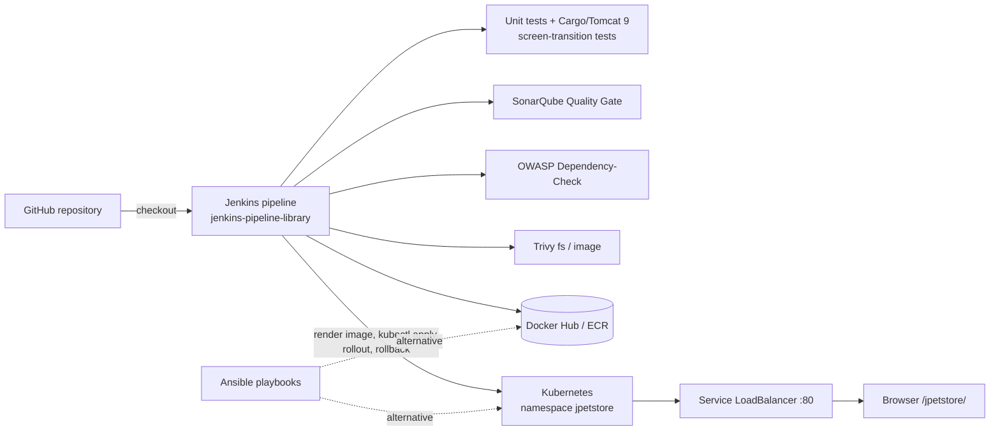

# JPetStore on Kubernetes with Jenkins, Docker and Ansible

A DevSecOps delivery layer for **MyBatis JPetStore 6**, the classic Java web shop sample. The application
code comes from the upstream MyBatis project and is not modified here. This repository adds a production
container image, hardened Kubernetes manifests, Ansible playbooks and a Jenkins pipeline around it.

## Table of Contents

- [Project Overview](#project-overview)
- [Key Features](#key-features)
- [Architecture Overview](#architecture-overview)
- [Technology Stack](#technology-stack)
- [Project Structure](#project-structure)
- [Prerequisites](#prerequisites)
- [Installation and Configuration](#installation-and-configuration)
- [Execution and Deployment](#execution-and-deployment)
- [Testing and Validation](#testing-and-validation)
- [CI/CD Pipeline](#cicd-pipeline)
- [Security Implementation](#security-implementation)
- [Known Limitations](#known-limitations)
- [License](#license)
- [Attribution](#attribution)
- [Author](#author)

## Project Overview

| Area | From upstream MyBatis JPetStore 6 | Added in this repository (DevOps layer) |
|---|---|---|
| Application | `src/`, `pom.xml`, Maven Wrapper, `format.xml`, `LICENSE_HEADER` | — (unchanged) |
| Development setup | Root `Dockerfile` and `docker-compose.yaml` | — (unchanged) |
| Upstream workflows | `ci.yaml`, `support.yaml`, `codeql.yaml`, `coveralls.yaml`, `sonar.yaml`, `sonatype.yaml`, `site.yaml`, `cleanup.yaml` | — (unchanged) |
| Container | | `deploy/docker/Dockerfile`: multi-stage, Tomcat 9 + JRE 21, non-root, exploded WAR, health check |
| Kubernetes | | `deploy/kubernetes/`: `restricted` Pod Security, read-only root filesystem, probes, resources |
| Automation | | `deploy/ansible/`: build-and-push and deploy playbooks |
| CI/CD | | `Jenkinsfile` (uses `jenkins-pipeline-library` `v1.0.0`), `.github/workflows/devops.yml` |
| Security | | `trivy.yaml`, `.trivyignore`, `.groovylintrc.json` |
| Documentation | Upstream README kept as `README.upstream.md` | This README, DevOps section appended to `NOTICE`, additions to `.gitignore` |

## Key Features

- Unit tests and the upstream Selenide screen-transition tests (headless Chrome against Tomcat 9 started by
  Cargo) run in the Jenkins pipeline.
- Immutable image tags (`<build>-<git sha>`) pushed to **Docker Hub or Amazon ECR**.
- Security gates that fail the build: SonarQube Quality Gate, OWASP Dependency-Check (CVSS ≥ 7), Trivy
  (HIGH/CRITICAL).
- Rolling deployment that starts the new pod before removing the old one (`maxSurge: 1`,
  `maxUnavailable: 0`). The Jenkins deployment rolls back automatically when the rollout fails.
- Ansible alternative for building, pushing and deploying without Jenkins.

## Architecture Overview



Runtime: one Tomcat 9 pod serves the exploded WAR at `/jpetstore/`, with an in-memory HSQLDB initialised at
startup (upstream design).

## Technology Stack

| Area | Tools |
|---|---|
| Application (upstream) | Java 11 bytecode, MyBatis 3.6, MyBatis-Spring, Spring Framework 5.3 (Spring MVC), JSP/JSTL, HSQLDB (in-memory) |
| Build and tests | Maven Wrapper, JDK 21, JUnit Jupiter, Mockito, AssertJ, Selenide, Cargo (Tomcat 9) |
| Runtime | Tomcat 9 on Eclipse Temurin JRE 21 |
| Containers and orchestration | Docker (BuildKit), Kubernetes |
| Automation | Ansible (`community.docker`, `kubernetes.core`) |
| CI/CD | Jenkins, GitHub Actions |
| Quality and security | SonarQube, OWASP Dependency-Check, Trivy, kubeconform, ansible-lint, Gitleaks |

## Project Structure

```text
.
├── src/ pom.xml mvnw mvnw.cmd .mvn/      # Upstream application (unchanged)
├── Dockerfile docker-compose.yaml        # Upstream development container (unchanged)
├── README.upstream.md                    # Upstream README
├── LICENSE NOTICE LICENSE_HEADER         # Apache License 2.0, notices, upstream header template
├── deploy/                               # DevOps layer
│   ├── docker/Dockerfile                 # Production image
│   ├── kubernetes/                       # 00-namespace, 20-deployment, 30-service
│   └── ansible/                          # build-and-push.yml, deploy-kubernetes.yml, group_vars, inventory example
├── Jenkinsfile                           # CI/CD pipeline
├── trivy.yaml .trivyignore               # Trivy scope and documented exception
└── .github/workflows/
    ├── devops.yml                        # DevOps layer checks
    └── ci.yaml, codeql.yaml, …           # Upstream workflows
```

## Prerequisites

| For | Requirement |
|---|---|
| Build and unit tests | JDK 21 (Maven is provided by the wrapper) |
| Integration tests | Google Chrome or Chromium on the machine or Jenkins agent (the Selenide tests run headless Chrome) |
| Image | Docker with BuildKit enabled |
| Deployment | A Kubernetes cluster (EKS, Minikube, kind…) and `kubectl` |
| Ansible path | Python 3, `pip install ansible docker kubernetes` (the `ansible` package includes the `community.docker` and `kubernetes.core` collections; the `docker` and `kubernetes` Python libraries are required by their modules) |
| Pipeline | Jenkins with the plugins, tools and credentials listed in [CI/CD Pipeline](#cicd-pipeline) |

## Installation and Configuration

```bash
git clone https://github.com/ElloughWassim/jpetstore-kubernetes-deployment.git
cd jpetstore-kubernetes-deployment
./mvnw -B package -Dlicense.skip=true
```

`-Dlicense.skip=true` disables the upstream license-header plugin, which would otherwise rewrite file
headers during the build. The upstream workflows use the same flag.

| Where | What to set |
|---|---|
| `Jenkinsfile` → `environment` | `DOCKERHUB_NAMESPACE`, `AWS_ACCOUNT_ID`, `AWS_REGION` (default `eu-west-1`) |
| `deploy/ansible/group_vars/all.yml` | Defaults only. Pass `-e image_repository=… -e image_tag=…` on the command line. `registry_url` defaults to Docker Hub |
| Environment (Ansible) | `REGISTRY_USERNAME`, `REGISTRY_PASSWORD` (Docker Hub access token), optional `KUBECONFIG` |
| `deploy/ansible/inventory/hosts.ini` | Copy of `hosts.example.ini` (git-ignored) |
| `deploy/kubernetes/30-service.yaml` | `type: LoadBalancer` (cloud) or `NodePort` / port-forward (local clusters) |

## Execution and Deployment

```bash
# Upstream way: Tomcat 9 started by Cargo
./mvnw cargo:run -P tomcat9 -Dlicense.skip=true         # http://localhost:8080/jpetstore/

# Production image
docker build -f deploy/docker/Dockerfile -t jpetstore .
docker run --rm -p 8080:8080 jpetstore                  # http://localhost:8080/jpetstore/

# Kubernetes (manual)
sed 's|IMAGE_PLACEHOLDER|<registry>/jpetstore:<tag>|' deploy/kubernetes/20-deployment.yaml > /tmp/jpetstore.yaml
kubectl apply -f deploy/kubernetes/00-namespace.yaml -f /tmp/jpetstore.yaml -f deploy/kubernetes/30-service.yaml
kubectl -n jpetstore rollout status deployment/jpetstore

# Kubernetes (Ansible)
cd deploy/ansible && cp inventory/hosts.example.ini inventory/hosts.ini
export REGISTRY_USERNAME=<user> REGISTRY_PASSWORD=<token>
ansible-playbook build-and-push.yml    -e image_repository=<user>/jpetstore -e image_tag=1.0.0
ansible-playbook deploy-kubernetes.yml -e image_repository=<user>/jpetstore -e image_tag=1.0.0
```

The deploy playbook applies every manifest in `deploy/kubernetes/` with the image placeholder replaced and
waits for the resources to become ready (`wait_timeout` 300 s). Unlike the Jenkins step, it does not roll
back automatically.

## Testing and Validation

```bash
./mvnw test -Dlicense.skip=true                 # unit tests
./mvnw verify -P tomcat9 -Dlicense.skip=true    # + screen-transition integration tests on Tomcat 9
```

The test suites come from upstream: domain, mapper, service and controller unit tests, and
`ScreenTransitionIT` (Selenide, headless Chrome) for the integration tests.

## CI/CD Pipeline

### Jenkins (`Jenkinsfile`)

```text
Unit tests → Integration tests (Cargo + Tomcat 9) → SonarQube → Quality gate → OWASP Dependency-Check
  → Trivy fs → Docker build (deploy/docker/Dockerfile) → Trivy image → Push (Docker Hub | ECR)
  → Deploy to Kubernetes (render image, apply, rollout status with 300 s timeout, automatic rollback)
```

- **Parameters:** `REGISTRY` (`dockerhub` | `ecr`), `DEPLOY` (default `true`).
- **Plugins:** Pipeline, Git, Credentials Binding, SonarQube Scanner, OWASP Dependency-Check, JUnit,
  Timestamper, and Pipeline: AWS Steps (or AWS Credentials) for ECR.
- **Agent tools:** JDK 21, Chrome or Chromium (integration tests), Docker, Trivy, kubectl, and the AWS CLI v2
  for ECR.
- **SonarQube:** server named `sonarqube` with a webhook to `<JENKINS_URL>/sonarqube-webhook/`.
- **Dependency-Check:** tool installation named `dependency-check`.

| Credential ID | Kind | Purpose |
|---|---|---|
| `dockerhub-credentials` | Username with password (access token) | Docker Hub push |
| `aws-credentials` | AWS Credentials | ECR push |
| `kubeconfig` | Secret file | Kubernetes deployment |
| `nvd-api-key` | Secret text | NVD API key for Dependency-Check |

### GitHub Actions

| Workflow | Origin | What it does |
|---|---|---|
| `devops.yml` | DevOps layer | Builds the production image, smoke-tests `/jpetstore/catalog`, runs the Trivy image scan and the Trivy fs/IaC scan, kubeconform on `deploy/kubernetes/`, Ansible syntax check and ansible-lint, Gitleaks over the full history |
| `ci.yaml`, `support.yaml`, `codeql.yaml`, `cleanup.yaml` | Upstream | Run in this repository as well |
| `coveralls.yaml`, `sonar.yaml`, `sonatype.yaml`, `site.yaml` | Upstream | Only run when the repository owner is `mybatis`, so they are skipped here |

## Security Implementation

- **Production image.** Build tools stay in the build stage, the runtime runs as UID 10001, Tomcat's default
  web applications are removed, and the application is deployed as an exploded directory so `webapps/` can
  stay read-only.
- **Pod.** `restricted` Pod Security Standard, `runAsNonRoot`, no privilege escalation, all capabilities
  dropped, read-only root filesystem (only `work/`, `temp/` and `logs/` are writable `emptyDir` volumes),
  `RuntimeDefault` seccomp profile, no service-account token.
- **Secrets.** Registry credentials come from Jenkins credentials or environment variables. The Ansible login
  task uses `no_log`. No secret is stored in the repository, and CI runs Gitleaks over the full history.
- **Scan scope.** `trivy.yaml` excludes only the upstream development `Dockerfile` and `docker-compose.yaml`
  (they run Maven and Cargo as root and are not deployed). `.trivyignore` documents the image-placeholder
  exception (`KSV-0013`).
- **Known upstream risk.** JPetStore 6 uses Spring Framework 5.3, whose open-source support has ended.
  Scanners may report CVEs that are only fixed in Spring 6 or in commercial 5.3 releases. Fixing this
  requires an application migration (`javax` → `jakarta`), which is out of scope for this DevOps layer.

## Known Limitations

- The in-memory HSQLDB and the HTTP sessions are per pod, so the Deployment runs a single replica. During a
  rollout, carts and data held by the old pod are lost. Scaling out would require an external database and
  sticky sessions or session replication.
- The Ansible deploy playbook waits for readiness but does not roll back on failure.

## License

This repository is distributed under the **Apache License, Version 2.0**, the license of the upstream
MyBatis JPetStore 6 project. See [`LICENSE`](LICENSE) and [`NOTICE`](NOTICE).

The DevOps layer added in this repository is also licensed under the Apache License, Version 2.0, as stated
in `NOTICE`. Upstream source files keep their original copyright and license headers.

## Attribution

- **MyBatis JPetStore 6**, Copyright the original author or authors (The MyBatis Team), licensed under the
  Apache License, Version 2.0. Source: [mybatis/jpetstore-6](https://github.com/mybatis/jpetstore-6).
  The original README is preserved as [`README.upstream.md`](README.upstream.md).
- Third-party notices for components bundled by the upstream project (iBATIS, OGNL) are listed in
  [`NOTICE`](NOTICE).
- The DevOps layer (`deploy/`, `Jenkinsfile`, `trivy.yaml`, `.trivyignore`, `.groovylintrc.json`,
  `.github/workflows/devops.yml`, this README and the additions to `.gitignore` and `NOTICE`) is the work of
  ElloughWassim.

Application issues belong to the upstream project.

## Author

DevOps layer by **ElloughWassim** · [github.com/ElloughWassim](https://github.com/ElloughWassim)
