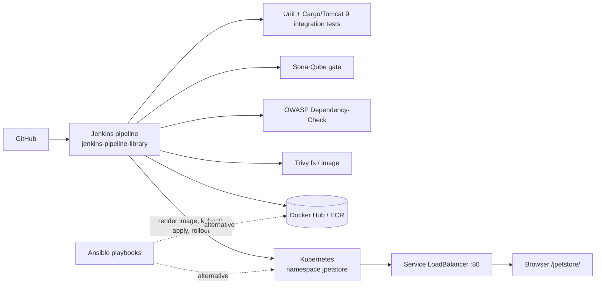

# JPetStore  on Kubernetes with Jenkins, Docker and Ansible

[](https://github.com/ElloughWassim/jpetstore-kubernetes-deployment/actions/workflows/devops.yml)
[](https://github.com/ElloughWassim/jpetstore-kubernetes-deployment/actions/workflows/ci.yaml)
[](LICENSE)

A production-style delivery pipeline for **MyBatis JPetStore , the classic Java web shop sample. The
application is the unmodified upstream project. This repository adds a container image, hardened Kubernetes
manifests, Ansible playbooks and a Jenkins DevSecOps pipeline around it.


## Project overview

| | Upstream MyBatis JPetStore 6 | What this fork adds (ElloughWassim) |
|---|---|---|
| Code | `src/`, `pom.xml`, Maven Wrapper, upstream workflows, root `Dockerfile` / `docker-compose.yaml` (dev setup) | nothing changed |
| Container | | `deploy/docker/Dockerfile`: multi-stage, Tomcat 9 + JRE 21, non-root, exploded WAR, health check |
| Kubernetes | | `deploy/kubernetes/`: restricted Pod Security, read-only root filesystem, probes, resources |
| Automation | | `deploy/ansible/`: idempotent build/push and deploy playbooks |
| CI/CD | | `Jenkinsfile` (via [jenkins-pipeline-library](https://github.com/ElloughWassim/jenkins-pipeline-library)), `.github/workflows/devops.yml` |
| Security | | Trivy (fs, IaC, image), OWASP Dependency-Check, SonarQube gate, gitleaks |
| Docs | | this README, `NOTICE` addition |

## Main features

- Unit tests and the upstream Selenide/HtmlUnit screen-transition tests on Tomcat 9 run in the pipeline.
- Immutable image tags (`<build>-<git sha>`) pushed to **Docker Hub or Amazon ECR**.
- Security gates (SonarQube, OWASP Dependency-Check CVSS ≥ 7, Trivy HIGH/CRITICAL) that fail the build.
- Zero-downtime deployment with automatic rollback, from Jenkins or Ansible.

## Technologies and tools

Java 21 (build) / Java 11 bytecode · MyBatis 3 · Spring 5 · Tomcat 9 · Maven · HSQLDB (in-memory) · Docker ·
Kubernetes · Ansible (`community.docker`, `kubernetes.core`) · Jenkins · SonarQube · OWASP Dependency-Check ·
Trivy · GitHub Actions

## Architecture overview



Runtime: one Tomcat 9 pod serving the exploded WAR at `/jpetstore/`, with an in-memory HSQLDB initialised at
startup (upstream design).

## Repository structure

```
.
├── src/ pom.xml mvnw .mvn/          # Upstream application (unchanged)
├── Dockerfile docker-compose.yaml   # Upstream development container (unchanged)
├── README.upstream.md               # Upstream README
├── deploy/                          # ← DevOps layer
│   ├── docker/Dockerfile            # Production image
│   ├── kubernetes/                  # 00-namespace, 20-deployment, 30-service
│   └── ansible/                     # build-and-push.yml, deploy-kubernetes.yml, group_vars, inventory example
├── Jenkinsfile                      # ← CI/CD pipeline
├── trivy.yaml .trivyignore          # ← Trivy scope and documented exception
└── .github/workflows/
    ├── devops.yml                   # ← image smoke test, Trivy, kubeconform, ansible-lint, gitleaks
    └── ci.yaml, codeql.yaml, …      # upstream workflows (org-gated ones stay inactive here)
```

## Prerequisites

| For | You need |
|---|---|
| Build and tests | JDK 21 (Maven is provided by the wrapper) |
| Image | Docker 24+ with BuildKit |
| Deployment | A Kubernetes cluster (EKS, Minikube, kind…) and `kubectl` |
| Ansible path | Python 3, `pip install ansible` (includes `community.docker` and `kubernetes.core`), plus `pip install kubernetes` |
| Pipeline | Jenkins with the plugins listed below |

## Installation

```bash
git clone https://github.com/ElloughWassim/jpetstore-kubernetes-deployment.git
cd jpetstore-kubernetes-deployment
./mvnw -B package -Dlicense.skip=true
```

`-Dlicense.skip=true` disables the upstream license-header formatter, which would otherwise add headers to
files during the build. The upstream CI uses the same flag.

## Configuration

| Where | What to set |
|---|---|
| `Jenkinsfile` `environment` | `DOCKERHUB_NAMESPACE`, `AWS_ACCOUNT_ID`, `AWS_REGION` |
| `deploy/ansible/group_vars/all.yml` | defaults only; pass `-e image_repository=… -e image_tag=…` |
| Environment (Ansible) | `REGISTRY_USERNAME`, `REGISTRY_PASSWORD` (Docker Hub access token), optional `KUBECONFIG` |
| `deploy/kubernetes/30-service.yaml` | `type: LoadBalancer` (cloud) or `NodePort` (local clusters) |

## How to run the project

```bash
# Upstream way: Tomcat started by Cargo
./mvnw cargo:run -P tomcat9 -Dlicense.skip=true          # http://localhost:8080/jpetstore/

# Production image
docker build -f deploy/docker/Dockerfile -t jpetstore .
docker run --rm -p 8080:8080 jpetstore                   # http://localhost:8080/jpetstore/

# Kubernetes (manually)
sed 's|IMAGE_PLACEHOLDER|<registry>/jpetstore:<tag>|' deploy/kubernetes/20-deployment.yaml > /tmp/jpetstore.yaml
kubectl apply -f deploy/kubernetes/00-namespace.yaml -f /tmp/jpetstore.yaml -f deploy/kubernetes/30-service.yaml
kubectl -n jpetstore rollout status deployment/jpetstore

# Kubernetes (Ansible)
cd deploy/ansible && cp inventory/hosts.example.ini inventory/hosts.ini
export REGISTRY_USERNAME=<user> REGISTRY_PASSWORD=<token>
ansible-playbook build-and-push.yml   -e image_repository=<user>/jpetstore -e image_tag=1.0.0
ansible-playbook deploy-kubernetes.yml -e image_repository=<user>/jpetstore -e image_tag=1.0.0
```

## How to execute tests

```bash
./mvnw test -Dlicense.skip=true                     # unit tests
./mvnw verify -P tomcat9 -Dlicense.skip=true        # + screen-transition integration tests on Tomcat 9
```

## CI/CD pipeline

**Jenkins (`Jenkinsfile`):** Unit tests → Integration tests (Cargo + Tomcat 9) → SonarQube → Quality gate →
OWASP Dependency-Check → Trivy fs → Docker build → Trivy image → Push → Deploy to Kubernetes
(render image, apply, rollout status, automatic rollback).

- **Parameters:** `REGISTRY` (`dockerhub` | `ecr`), `DEPLOY`.
- **Plugins:** Pipeline, Git, Credentials Binding, SonarQube Scanner, OWASP Dependency-Check, JUnit, Timestamper,
  and Pipeline: AWS Steps for ECR.
- **Agent tools:** JDK 21, Docker, Trivy, kubectl, plus the AWS CLI for ECR.
- **Credentials:** `dockerhub-credentials` (username + token), `aws-credentials` (ECR), `kubeconfig` (secret file),
  `nvd-api-key` (secret text).
- **SonarQube** server named `sonarqube` with a webhook to `<JENKINS_URL>/sonarqube-webhook/`.
  **Dependency-Check** tool named `dependency-check`.

**GitHub Actions:**
- `devops.yml` builds the production image, smoke-tests `/jpetstore/catalog`, runs the Trivy image and fs/IaC
  scans, kubeconform and ansible-lint, and scans the full history with gitleaks.
- The upstream `ci.yaml`, `support.yaml` and `codeql.yaml` keep running. The upstream `coveralls`, `sonar`,
  `sonatype` and `site` workflows only run in the `mybatis` organisation.

## Security considerations

- Production image: no build tools, non-root UID 10001, Tomcat default apps removed, `webapps/` read-only.
- Pod: `restricted` Pod Security Standard, no privilege escalation, all capabilities dropped, read-only root
  filesystem (only `work/`, `temp/` and `logs/` are writable `emptyDir` volumes), `RuntimeDefault` seccomp,
  no service-account token.
- Registry credentials come from Jenkins credentials or environment variables, and the Ansible login task is
  `no_log`. Nothing secret is stored in the repository. History was scanned with gitleaks: no findings.
- **Known upstream risk:** JPetStore 6 uses Spring Framework 5.3, whose open-source support has ended. Scanners
  may report CVEs that are only fixed in Spring 6 or in commercial 5.3 releases. Changing that is an
  application migration (javax → jakarta), so it is out of scope for this DevOps layer.
- `trivy.yaml` excludes only the upstream development `Dockerfile`/`docker-compose.yaml` (run as root, not
  deployed). `.trivyignore` documents the image-placeholder exception.

## Known limitations

- The in-memory HSQLDB and HTTP sessions are per pod, so the Deployment runs a single replica. Scaling out would
  need an external database and sticky sessions or session replication.


## Maintainer

DevOps layer maintained by **ElloughWassim**, [github.com/ElloughWassim](https://github.com/ElloughWassim).
Application issues belong upstream at [mybatis/jpetstore-6](https://github.com/mybatis/jpetstore-6).
